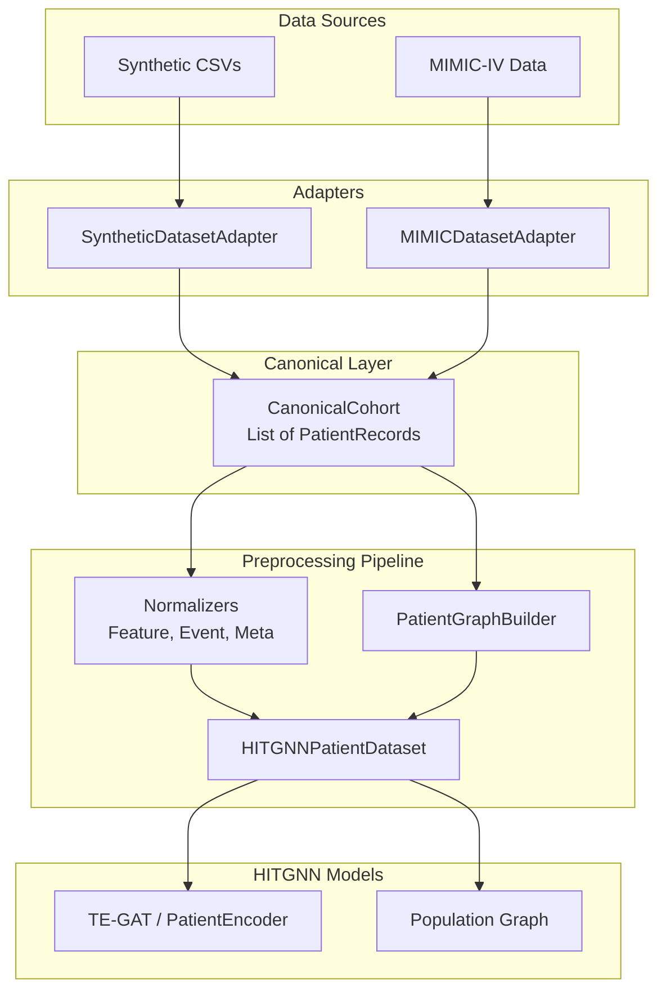

# HITGNN Data Architecture (Phase 8.5)

The HITGNN pipeline is designed to be completely independent of the underlying raw data source. To achieve this, it uses a modular data ingestion architecture based on the **Adapter Pattern**.

## Core Concepts

### 1. Canonical Structures
Downstream components of HITGNN (models, trainers, graph builders) do not know about synthetic generators or MIMIC-IV schemas. They only consume canonical data structures:

*   **`ClinicalEvent`**: A normalized representation of a single longitudinal event (e.g., a lab test, a medication administration, a vital sign).
*   **`PatientRecord`**: A canonical container for a single patient. It holds:
    *   Explicit static features (`age`, `sex`, `icu_type`, `sofa_score`, `comorbidities`).
    *   A list of `ClinicalEvent` objects.
    *   The `mortality` target label.
    *   The temporal anchor `t0`.
*   **`CanonicalCohort`**: The definitive collection of `PatientRecord`s for a dataset. It is the authoritative source of truth for:
    *   Patient membership.
    *   Fixed split assignments (`train_ids`, `val_ids`, `test_ids`).

### 2. Dataset Adapters
To introduce a new data source to HITGNN, you must implement a subclass of `BaseDatasetAdapter`. The adapter's sole responsibility is to translate raw data from the external source into the canonical structures.

*   **`SyntheticDatasetAdapter`**: Loads the pre-generated synthetic CSVs (`data/synthetic/patients.csv`, `data/synthetic/events.csv`, `data/synthetic/splits.json`) and translates them into a `CanonicalCohort`. It *never* regenerates data; it only ingests.
*   **`MIMICDatasetAdapter`**: (Future) Will load data from MIMIC-IV CSVs or databases and translate them into the same `CanonicalCohort` format.

Adapters are instantiated via the `create_dataset_adapter(config)` factory function.

### 3. Shared Preprocessing Pipeline
Once a `CanonicalCohort` is generated by an adapter, it is passed to the shared preprocessing pipeline (`build_hitgnn_datasets`). This pipeline handles all source-agnostic transformations:
1.  **Feature Normalization**: Fitting z-score/min-max normalizers for continuous biomarkers and event values.
2.  **Metadata Normalization**: Normalizing patient static features (age, SOFA).
3.  **Graph Construction**: Translating temporal events into PyTorch Geometric graphs.
4.  **Dataset Construction**: Wrapping the graphs into `HITGNNPatientDataset` instances for PyTorch `DataLoader`s.

**Crucially, normalization statistics are fitted exclusively on the training split**, which is enforced by filtering the `CanonicalCohort` using its authoritative `train_ids` list before fitting.

## Architecture Flow

## Creating a New Adapter

To add a new data source (e.g., eICU):
1.  Create `src/data/adapters/eicu.py`.
2.  Implement `EICUDatasetAdapter` inheriting from `BaseDatasetAdapter`.
3.  Implement `load_patients()`, `load_events()`, and `validate()`.
4.  Register the adapter in `src/data/factory.py` under the `"eicu"` key.
5.  Update the configuration file to `adapter: "eicu"`. No model code changes are required.
